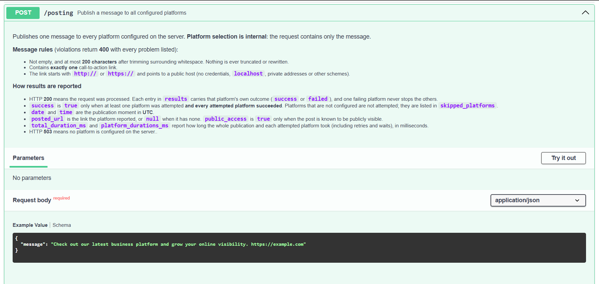
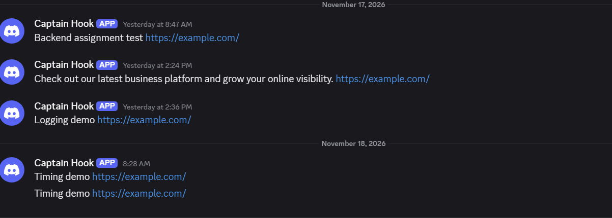

# Automated Multi-Platform Posting System

A FastAPI backend that publishes one message, containing exactly one call-to-action link, to several third-party platforms in a single request. Platform selection is internal, every platform runs independently, and one platform failing never stops the others.

Author: Kaustubh Somnath Pawar. License: MIT.

## 1. Project overview

`POST /posting` accepts `{"message": "..."}`, validates it, publishes it to every configured platform through that platform's official API, and returns one result per platform: status, the post URL the platform reported, whether the post is publicly visible, the UTC date and time, and a safe error message when something failed.

Five platform adapters are implemented: Mastodon, Bluesky, Telegram, LinkedIn and Discord. Section 8 states exactly what has been verified against live services and what has only been tested with mocked HTTP.

## 2. Problem statement

Publishing the same announcement to several platforms by hand is slow and error-prone, and a naive loop is fragile: one platform's outage or authentication problem blocks or hides the rest, and retrying a timed-out request can publish the same post twice. This service solves that by validating the message once, running each platform independently with its own deadline, retrying only where a retry cannot create a duplicate, and reporting honestly what each platform actually did.

## 3. Key features

- One endpoint, `POST /posting`; the client never chooses platforms.
- Strict validation: at most 200 characters, exactly one valid http(s) link, structured errors listing every problem at once.
- Five adapters behind one interface (Strategy and Adapter patterns) with a registry.
- Failure isolation: per-platform deadlines, bounded concurrency, and `asyncio.gather(return_exceptions=True)`.
- Duplicate-safe retries: exponential backoff with jitter, `Retry-After` honoured, and ambiguous failures retried only on platforms that support idempotency keys.
- Honest results: URLs come from the platform's response, `public_access` is true only with evidence, timestamps are UTC.
- Security: credentials only in environment variables (`SecretStr`), secret redaction in logs, HTTPS-only outbound calls restricted to each platform's own hosts, no redirects, the CTA link is never fetched.
- Observability: request IDs on every log line and error body, JSON logs in production, `GET /health`, `GET /platforms` diagnostics, per-platform timing.
- `DISABLED_PLATFORMS` switch and graceful shutdown (`python -m app`).
- 578 automated tests with 100% statement and branch coverage; no test publishes anything.

## 4. Technology stack

| Area | Choice |
|---|---|
| Language | Python 3.12 |
| Web framework | FastAPI 0.163, Uvicorn 0.54 |
| Validation and settings | Pydantic v2, pydantic-settings |
| HTTP client | HTTPX (async, shared connection pool) |
| Tests | pytest, pytest-asyncio, respx (HTTP mocking), pytest-cov |
| Lint | ruff |

## 5. Architecture

```text
Client -> RequestContextMiddleware -> POST /posting route -> validate_message
                                                   |
                                                   v
                                            PostingService
                                   (semaphore, deadline, retries)
                                                   |
              +----------+----------+----------+----------+
              v          v          v          v          v
          Mastodon    Bluesky    Telegram   LinkedIn    Discord
          (adapters implement the PlatformAdapter interface)
```

Details, a sequence diagram, the error taxonomy and the retry rules are in [docs/ARCHITECTURE.md](docs/ARCHITECTURE.md).

## 6. Folder structure

```text
automated-multi-platform-posting/
|-- app/
|   |-- __main__.py              python -m app (graceful shutdown timing)
|   |-- main.py                  application factory and lifespan
|   |-- api/                     routes, middleware, exception handlers, dependencies
|   |-- core/                    settings, exceptions, logging
|   |-- platforms/               base interface, registry, shared HTTP layer, 5 adapters
|   |-- schemas/                 request, response, error and health models
|   |-- services/                message validation, posting service, diagnostics
|   `-- utils/                   CTA URL extraction and validation
|-- scripts/linkedin_authorize.py   one-time LinkedIn OAuth helper
|-- tests/                       29 test modules, shared fixtures and fakes
|-- docs/                        architecture, API examples, platform research, evidence
|-- screenshots/                 execution screenshots
|-- .env.example                 placeholders only
|-- requirements.txt, requirements-dev.txt, pyproject.toml
`-- LICENSE, README.md
```

## 7. Platform API research

Seven platforms were researched (LinkedIn, Mastodon, Bluesky, Reddit, WordPress, Telegram, Discord). Five were implemented. Reddit was rejected because new API access requires manual approval that cannot be obtained in time. WordPress is feasible but was not implemented. Endpoints, authentication, limits, and the items that still need verification are in [docs/PLATFORM_API_RESEARCH.md](docs/PLATFORM_API_RESEARCH.md).

## 8. Platform integration status

Status as of 18 November 2026.

| Platform | Adapter | Mocked-HTTP tests | Verified against live service | Public visibility reported |
|---|---|---|---|---|
| Mastodon | Implemented | Yes | Not yet | From the visibility the server returns |
| Bluesky | Implemented | Yes | Not yet | `true` (AT Protocol records are public) |
| Telegram | Implemented | Yes | Not yet | `true` only for chats with a public username |
| LinkedIn | Implemented | Yes | Not yet | `true` (visibility `PUBLIC` is requested) |
| Discord | Implemented | Yes | **Yes**, see [docs/EXECUTION_EVIDENCE.md](docs/EXECUTION_EVIDENCE.md) | Always `false` (server channel) |
| Reddit | Not implemented | n/a | n/a | Rejected: needs manual API approval |
| WordPress | Not implemented | n/a | n/a | Feasible, left for future work |

"Verified live" means a real request through this service created a real post that was seen on the platform. Everything else is covered by tests that mock the platform's HTTP responses, so those adapters follow the documented API but have not been proven against the real service.

## 9. Authentication requirements

| Platform | Credential | Where to get it | Needs approval |
|---|---|---|---|
| Mastodon | Access token with only `write:statuses` | Preferences > Development > New application | No |
| Bluesky | Handle and app password | Settings > Privacy and security > App passwords | No |
| Telegram | Bot token; the bot must be a channel admin with "Post Messages" | @BotFather | No |
| LinkedIn | Member access token (scope `w_member_social`), about 60 days | Developer app, then `python scripts\linkedin_authorize.py` | Self-serve products |
| Discord | Webhook URL (contains a secret token) | Server Settings > Integrations > Webhooks | No |

## 10. Installation

Requirements: Python 3.12 and Git. Commands are for Windows PowerShell.

```powershell
git clone https://github.com/kaustubh-pawar-dev/automated-multi-platform-posting.git
cd automated-multi-platform-posting
```

## 11. Virtual environment setup

```powershell
py -3.12 -m venv .venv
.\.venv\Scripts\Activate.ps1
python -m pip install --upgrade pip
pip install -r requirements-dev.txt
```

If script execution is blocked: `Set-ExecutionPolicy -Scope CurrentUser -ExecutionPolicy RemoteSigned`. On macOS or Linux: `python3.12 -m venv .venv`, `source .venv/bin/activate`, then the same pip commands.

## 12. Environment variable configuration

```powershell
Copy-Item .env.example .env
```

Edit `.env` (never commit it; it is git-ignored). A platform is skipped when its values are blank.

| Variable | Purpose |
|---|---|
| `HOST`, `PORT` | Bind address (default `127.0.0.1:4000`) |
| `ENVIRONMENT` | `development`, `testing` or `production` (production logs JSON) |
| `LOG_LEVEL` | `DEBUG` to `CRITICAL` |
| `HTTP_TIMEOUT_SECONDS`, `HTTP_CONNECT_TIMEOUT_SECONDS` | Outbound timeouts |
| `MAX_CONCURRENT_PLATFORMS`, `MAX_RETRIES`, `RETRY_BACKOFF_BASE_SECONDS` | Concurrency and retry policy |
| `MASTODON_INSTANCE_URL`, `MASTODON_ACCESS_TOKEN` | Mastodon |
| `BLUESKY_HANDLE`, `BLUESKY_APP_PASSWORD` | Bluesky |
| `TELEGRAM_BOT_TOKEN`, `TELEGRAM_CHAT_ID` | Telegram |
| `LINKEDIN_ACCESS_TOKEN`, `LINKEDIN_PERSON_URN`, `LINKEDIN_TOKEN_EXPIRES_AT` | LinkedIn |
| `DISCORD_WEBHOOK_URL`, `DISCORD_GUILD_ID` (optional) | Discord |
| `DISABLED_PLATFORMS` | Comma-separated platforms to switch off, for example `LinkedIn,Telegram` |

## 13. Running the application

```powershell
python -m app
```

This starts the server on `http://127.0.0.1:4000` and waits for in-flight publications when stopped with Ctrl+C. Equivalent: `uvicorn app.main:app --host 127.0.0.1 --port 4000`.

- Swagger UI: http://localhost:4000/docs
- ReDoc: http://localhost:4000/redoc

Warning: every configured platform is live. A valid request publishes real posts. While testing, switch platforms off for that terminal, for example `$env:DISABLED_PLATFORMS = "Mastodon,Bluesky,Telegram,LinkedIn"`.

## 14. Running automated tests

```powershell
ruff check .
pytest -q
pytest -q --cov=app --cov-branch --cov-report=term-missing
```

No credentials are needed and nothing is published: every test mocks the network. The coverage run enforces a 97% floor and currently reports 100%.

## 15. API endpoint documentation

| Method and path | Purpose |
|---|---|
| `POST /posting` | Publish a message to every configured platform |
| `GET /health` | Liveness (never contacts a platform) |
| `GET /platforms` | Which platforms are configured and which variables are missing (names only) |
| `GET /docs`, `GET /redoc`, `GET /openapi.json` | Interactive and machine-readable documentation |

`POST /posting` status codes:

| Status | Meaning |
|---|---|
| 200 | Request processed; read `success` and each platform's `status` |
| 400 | The message breaks a business rule (length, link rules) |
| 413 | Declared request body larger than 64 KB |
| 422 | Malformed request (missing or unknown field, wrong type, invalid JSON) |
| 500 | Unexpected error (generic message, no internals) |
| 503 | No platform is configured on the server |

`success` is true only when at least one platform was attempted and every attempted platform succeeded. Platforms that are not configured are not attempted and are listed in `skipped_platforms`. `date` and `time` are UTC.

## 16. Sample request

```powershell
Invoke-RestMethod -Method Post -Uri http://127.0.0.1:4000/posting -ContentType "application/json" `
  -Body '{"message":"Check out our latest business platform and grow your online visibility. https://example.com"}'
```

```bash
curl -X POST http://127.0.0.1:4000/posting -H "Content-Type: application/json" \
  -d '{"message":"Check out our latest business platform and grow your online visibility. https://example.com"}'
```

## 17. Successful response example

A real response recorded on 17 November 2026 from a live Discord publication (the other four platforms were switched off for the run; see [docs/EXECUTION_EVIDENCE.md](docs/EXECUTION_EVIDENCE.md)):

```json
{
  "success": true,
  "total_platforms": 1,
  "successful_count": 1,
  "failed_count": 0,
  "results": [
    {
      "platform": "Discord",
      "status": "success",
      "posted_url": null,
      "public_access": false,
      "date": "2026-11-17",
      "time": "08:54:20",
      "error": null
    }
  ],
  "skipped_platforms": ["Mastodon", "Bluesky", "Telegram", "LinkedIn"]
}
```

`posted_url` is null in this recording because the optional `DISCORD_GUILD_ID` was not set yet. With it set, a later live run returned a working jump link (see [docs/EXECUTION_EVIDENCE.md](docs/EXECUTION_EVIDENCE.md), section 8). `public_access` is false because a Discord server channel is not publicly accessible. Newer versions also return `total_duration_ms` and `platform_durations_ms`.

## 18. Partial failure example

Illustrative (not a recorded run). The scenario is exercised by `test_partial_failure_retries_only_where_it_is_safe` in `tests/test_integration_posting.py`, which drives all five real adapters with mocked HTTP:

```json
{
  "success": false,
  "total_platforms": 2,
  "successful_count": 1,
  "failed_count": 1,
  "results": [
    {
      "platform": "Mastodon",
      "status": "success",
      "posted_url": "https://mastodon.example/@user/110000000000000000",
      "public_access": true,
      "date": "2026-11-15",
      "time": "10:30:00",
      "error": null
    },
    {
      "platform": "LinkedIn",
      "status": "failed",
      "posted_url": null,
      "public_access": false,
      "date": null,
      "time": null,
      "error": "Authentication failed"
    }
  ],
  "skipped_platforms": [],
  "total_duration_ms": 1204,
  "platform_durations_ms": {"Mastodon": 611, "LinkedIn": 1204}
}
```

## 19. Validation error examples

Real responses from the running server, all with the same envelope.

A message with no link (HTTP 400, recorded 17 November 2026):

```json
{
  "error": "validation_error",
  "message": "The message failed validation.",
  "details": [
    {"code": "MISSING_CTA_URL", "message": "Message must contain exactly one http:// or https:// link; none was found."}
  ],
  "request_id": "0bb0c98c80ab4b8ebc63127953a03c8a"
}
```

A client trying to choose platforms (HTTP 422, recorded 16 November 2026, before request IDs were added to error bodies; `request_id` is now populated):

```json
{
  "error": "request_validation_error",
  "message": "The request body is invalid.",
  "details": [
    {"code": "UNKNOWN_FIELD", "message": "platforms: Extra inputs are not permitted"}
  ],
  "request_id": null
}
```

More examples, including the 503 response, are in [docs/API_EXAMPLES.md](docs/API_EXAMPLES.md).

## 20. Screenshots

Swagger UI showing `POST /posting` with its documented responses:



The Discord channel showing messages published through this service (Discord displays local time, India Standard Time, which is UTC+5:30):



## 21. Known limitations

- **Live verification:** only Discord has been verified against a live service. The other adapters follow the documented APIs and are tested with mocked HTTP, but have not been proven live. A few details are flagged "verify" in the research document (Telegram's `retry_after` location and 404 meaning, and LinkedIn's post URL format).
- **LinkedIn:** self-serve tokens last about 60 days and cannot be refreshed in the background; re-run `scripts/linkedin_authorize.py`. `public_access` reflects the requested `PUBLIC` visibility; LinkedIn may still show logged-out visitors a login page. Personal profiles only.
- **Bluesky:** the API has no idempotency key, so ambiguous failures are never retried. The post URL is derived from the handle and record key. The session is cached in memory.
- **Telegram:** posts in a chat without a public username succeed but have no URL and `public_access` is false.
- **Discord:** posts go to a private server channel, so `public_access` is always false; a post link needs `DISCORD_GUILD_ID` and works only for server members.
- **Not implemented:** Reddit (manual API approval) and WordPress.
- **Service scope:** no API authentication or rate limiting for callers (outside the assignment), no persistence or queue (a crash mid-publication loses the report), and the 64 KB limit checks only a declared `Content-Length`, so production should sit behind a reverse proxy with a body limit. `GET /platforms` shows configuration state and should be network-restricted in production.
- Developed and tested on Windows with Python 3.12.

## 22. Security considerations

- Credentials live only in environment variables, loaded as `SecretStr`; `.env` is git-ignored and `.env.example` holds placeholders only. A test fails if the template contains a value for any secret-looking variable.
- Settings errors never echo the offending value; API errors use fixed messages and never include response bodies, exception texts, stack traces or submitted input.
- Log lines carry request IDs and never contain message text, query strings or headers. A redaction layer scrubs known secret values and common credential shapes (bearer tokens, Telegram bot URLs, Discord webhook URLs) from every line and traceback.
- Outbound calls are HTTPS only and restricted to each platform's own hosts; redirects are never followed; `httpx` request logging is disabled because Telegram and Discord put credentials in URLs.
- The CTA link is content to publish: it is validated as text and never fetched, so user input cannot trigger server-side requests. Credentials in the link, `localhost`, private addresses and non-http(s) schemes are rejected.
- `@everyone`, role and user mentions in a message can never ping anyone on Discord.

## 23. Future improvements

- Verify the remaining platforms live and record the evidence.
- WordPress adapter; Reddit once API access is granted.
- Persistent publication log and an idempotency store for the platforms that lack native idempotency.
- API authentication and rate limiting for callers.
- Automatic token refresh where a platform allows it.
- Metrics (Prometheus), a Dockerfile, and CI that runs lint, tests and coverage.