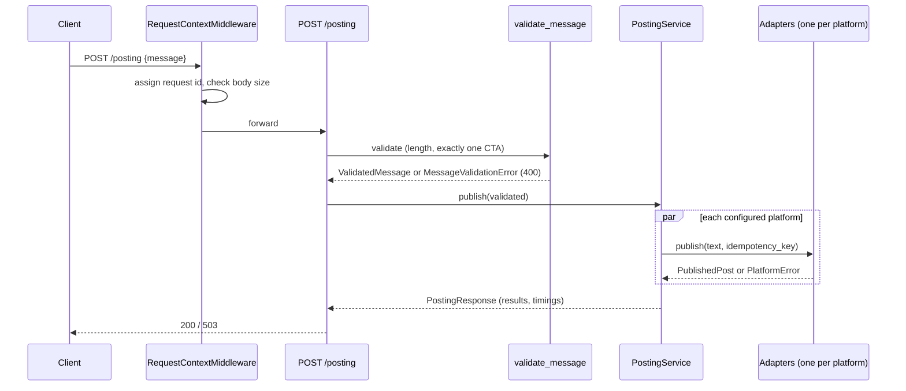

# Architecture

## Layers

| Layer | Package | Responsibility |
|---|---|---|
| API | `app/api` | Routes, request-context middleware, exception handlers, dependencies |
| Schemas | `app/schemas` | Pydantic request, response, error and health models |
| Services | `app/services` | Message validation, publication orchestration, diagnostics |
| Platforms | `app/platforms` | One adapter per platform behind a common interface, registry, shared HTTP layer |
| Core | `app/core` | Settings, exception hierarchy, logging and redaction |
| Utils | `app/utils` | CTA URL extraction and validation |

Dependencies point inward: routes call services, services call adapters through the interface, adapters use the shared HTTP layer. Nothing in `services` or `platforms` imports from `api`.

## Request flow

## Design patterns

- **Strategy and Adapter:** `PlatformAdapter` (`app/platforms/base.py`) is the contract; each adapter translates one platform's API into `PublishedPost` or a `PlatformError`.
- **Registry:** `PlatformRegistry` holds adapters; `build_registry` creates them from settings. Adding a platform means one new adapter and one line in the registry; `PostingService` does not change (Open/Closed).
- **Dependency injection:** the shared HTTP client, registry and posting service are created in the application lifespan, stored on `app.state` and exposed through FastAPI dependencies. Tests replace them with fakes.
- **Factory:** `create_app(settings)` builds an isolated application per test.

## Failure handling

Adapters raise typed errors; the service turns every error into that platform's failed result, so one platform can never affect another.

| Error | Retryable | Ambiguous* | Typical cause |
|---|---|---|---|
| `PlatformNotConfiguredError` | No | No | Missing credentials |
| `PlatformAuthError` | No | No | 401, 403, expired token |
| `PlatformRejectedError` | No | No | Other 4xx |
| `PlatformRateLimitError` | Yes | No | 429 |
| `PlatformTimeoutError` | Yes | Read timeout: yes | Slow platform |
| `PlatformUnavailableError` | Yes | 5xx and dropped connections: yes | Outage |
| `PlatformResponseError` | No | Success status with bad body: yes | Malformed response |

\* *Ambiguous* means the post may already exist. The service retries an ambiguous failure only when the adapter reports `idempotent_retries` (Mastodon, through its `Idempotency-Key` header). Bluesky, Telegram, LinkedIn and Discord have no idempotency mechanism, so those failures are reported, not retried.

## Concurrency and timing

- Platforms run concurrently under `asyncio.gather(return_exceptions=True)`, bounded by a semaphore (`MAX_CONCURRENT_PLATFORMS`).
- Each platform has one deadline covering all of its attempts and waits: `(MAX_RETRIES + 1) * HTTP_TIMEOUT_SECONDS`.
- Backoff is `base * 2^n` with jitter between 50% and 100%, capped at 10 seconds, never shorter than `Retry-After`. A retry is skipped when the wait would exceed the remaining deadline.
- One idempotency key is generated per platform per publication and reused on every retry.
- Response fields `total_duration_ms` and `platform_durations_ms` report timing.

## Result honesty

- `posted_url` comes from the platform's response (Bluesky, LinkedIn and Discord derive a link from identifiers the platform returned) and is null when none exists.
- `public_access` is true only with evidence: a visibility the server reported, a requested `PUBLIC` visibility, or a public Telegram username.
- Dates and times are UTC; each adapter documents where its timestamp comes from.
- A result that claims success must carry a date and time; a failed result cannot carry a URL (enforced by `PlatformResult`).

## Security model

Credentials are `SecretStr`; secrets are redacted from logs; errors use fixed messages; outbound requests are HTTPS-only, restricted to each platform's hosts, never follow redirects, and never fetch the CTA link. See README section 22.

## Testing strategy

| Concern | Where |
|---|---|
| Validation rules and URL edge cases | `test_message_validation.py`, `test_url_validator.py` |
| Each adapter (requests, auth headers, parsing, errors, retries) | `test_mastodon.py`, `test_bluesky.py`, `test_telegram.py`, `test_linkedin.py`, `test_discord.py`, `test_platform_http.py` |
| Orchestration, retries, timeouts, concurrency | `test_posting_service.py`, `test_timing.py` |
| HTTP behaviour and error mapping | `test_posting_api.py`, `test_error_handling.py`, `test_request_context.py` |
| Whole stack with five real adapters, mocked network | `test_integration_posting.py` |
| Security properties | `test_secret_safety.py`, `test_outbound_security.py`, `test_logging.py`, `test_repo_hygiene.py` |
| Settings and configuration | `test_config*.py`, `test_platform_toggle.py` |
| Operations | `test_health_api.py`, `test_entrypoint.py`, `test_app_lifecycle.py` |

Tests never publish and never need credentials.

## Adding a platform

1. Create `app/platforms/<name>.py` with a `PlatformAdapter` subclass; use `send_request` and `raise_for_status` from `app/platforms/http.py`.
2. Add its settings to `app/core/config.py` and `.env.example` (secrets as `SecretStr`).
3. Register it in `build_registry` and add it to `PLATFORM_SETTINGS` in `app/services/diagnostics.py`.
4. Add `tests/test_<name>.py` with mocked HTTP; the suite fails if the diagnostics map or the credential template is incomplete.